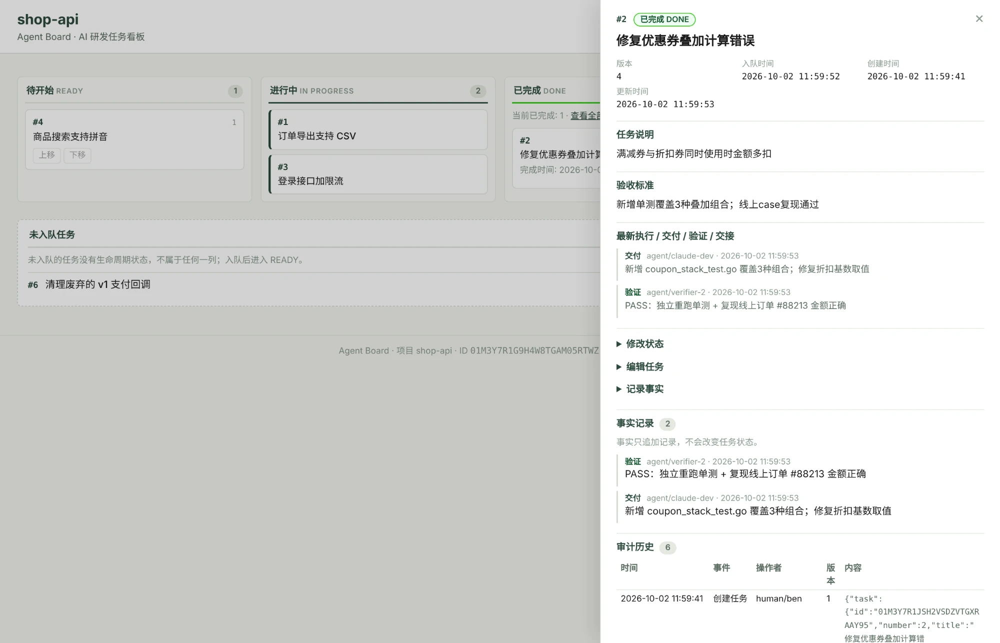

# Agent Board · Accountable AI software delivery

[English](README.md) | [简体中文](README.zh-CN.md)

**Clear tasks. Identifiable deliveries. Independent verification. A record you can come back to.**

Agent Board is a lightweight work protocol for AI-assisted software development. It defines what an agent has been asked to deliver, how to hand work off, and how a result is independently checked before acceptance.

`aboard` is the local reference implementation: a shared task ledger that works across Codex, Claude Code, OpenCode, other harnesses, and separate agent sessions. It is **not** another coding agent or scheduler.

## Quick start

### 1. Install with your agent (recommended)

In Codex, Claude Code, OpenCode, or another agent, paste:

> Install and verify Agent Board for a Git repository I will specify. Follow the installation guide at https://github.com/boboty/agent-board/blob/main/docs/install-with-agent_EN.md. First confirm the OS, harness, and target repository. Install the `management` and `workflow` skills without overwriting modified copies, run `aboard init` and `aboard doctor` in that repository only, and report what worked or failed. Do not create or queue a Task, run agents, or push changes until I ask.

Prefer step-by-step instructions? See [Install with your agent](docs/install-with-agent_EN.md).

**Manual alternative:** Download the binary for macOS, Linux, or Windows from [Releases](https://github.com/boboty/agent-board/releases) and place `aboard` on your `PATH`, then run:

```sh
aboard version
aboard skill install
cd /path/to/your/git-repository
aboard init
aboard doctor
aboard web
```

Or install using Go 1.25+:

```sh
go install github.com/boboty/agent-board/cmd/aboard@latest
```

The Go installation provides the binary; run `aboard skill install` and the initialization commands above afterward. See [Operations](docs/operations_EN.md) for upgrades and troubleshooting.

### 2. Create your first Task

Tell your agent:

> Create an unqueued Board Task for this bug or feature, with a clear scope and independently checkable acceptance criteria. Do not start implementation yet.

Review the Task; queue it as **READY** only after accepting its definition. Then ask:

> Execute the READY Task following `agent-board-workflow`. Use a Worker for implementation and a fresh, separate Independent Verifier for acceptance checks. Stop and ask when a Human decision is needed.

Start `aboard web` to inspect the Task, its deliveries, verification facts, and decision history.

[Walk through your first Task →](docs/first-task_EN.md)


## How a Task reaches DONE

1. **Define and authorize.** A Task has a goal, scope, constraints, and acceptance criteria. Creating it is not permission to execute; queueing it as `READY` is.
2. **Execute and deliver.** A Worker produces a stable workspace and a `delivery` fact identifying the baseline, fingerprint, evidence, and limitations.
3. **Verify independently.** A fresh, read-only Independent Verifier examines the delivery and records `PASS`, `RC` (return for correction), or `BLOCKED`. The Worker's self-check is not independent verification.
4. **Accept and close.** The Orchestrator closes the Task only after the verified content is packaged as the accepted commit, or a Human explicitly accepts it through a separate `decision` fact. A verdict never changes Task state automatically.

After `RC`, a new delivery is independently evaluated. Valid prior evidence may be reused **only after checking its applicability to the changed delivery**; impacted or uncertain checks must be rerun. See [the workflow specification](workflow/SKILL.md) and [RC evidence examples (Chinese)](docs/rc-evidence-examples.md).



## Why not an internal TODO or a chat summary?

An agent can manage its own steps. A shared Task must also survive a different agent, session, harness, or worktree:

- **A contract instead of a vague request:** what counts as acceptable is written before execution.
- **An identifiable result:** the verifier checks the delivery tied to a specific baseline and fingerprint.
- **Separate responsibilities:** the Worker does not issue its own `PASS`; a Human decision is not disguised as verification.
- **An auditable handoff:** execution, delivery, verification, decisions, and handoff facts remain available after a session ends.

Only work worth **independent scheduling, verification, or handoff** belongs on the Board. Internal plans and substeps stay in the execution tool.

## What `aboard` does — and does not do

| It provides today | It deliberately leaves to other tools or rules |
| --- | --- |
| Local Tasks, `READY / IN_PROGRESS / DONE / BLOCKED`, ordered queue | Starting agents, scheduling workers, or selecting models |
| Structured delivery and verification facts, audit events | Deciding that an agent's claim is true without verification |
| CLI, MCP, and Web views of the same ledger | Coding-agent conversations, plans, and general project memory |
| One local Board shared across Git worktrees of a clone | Cross-machine shared ledgers or a distributed node network |

The **Workflow Skill** defines role responsibilities and acceptance rules; **the Board** records facts reliably. The Board does not authenticate agent roles or technically enforce every workflow rule. Facts recorded through `aboard` are append-only, but the local SQLite database is **not tamper-proof**.

Project identity is local to each Git clone. All worktrees of that clone share its Board, while independent clones initialize their own. For engineering quality requirements, use the relevant engineering standard independently of the task ledger.

## Longer-term direction

The present product is a practical system for AI-assisted software delivery. A broader direction is a **portable collaboration protocol** in which a Goal owns a ledger, Tasks carry contracts, Deliveries carry evidence, and Governance determines acceptance — without binding work to one model, harness, or centralized coordinator. This is a design direction, **not a claim that v0.2.3 already implements Goals or cross-node coordination**.

[Read the project whitepaper →](docs/WHITEPAPER.md)

## Documentation

- [Installation with an agent](docs/install-with-agent_EN.md) · [First Task](docs/first-task_EN.md) · [Daily usage](docs/usage_EN.md)
- [Workflow Skill](workflow/SKILL.md) · [Best practices](docs/best-practices.md) · [Operations](docs/operations_EN.md)
- [Product definition](PRODUCT.md) · [Architecture](ARCHITECTURE.md) · [Development](docs/development.md)
- [Whitepaper](docs/WHITEPAPER.md) · [白皮书（中文）](docs/WHITEPAPER.zh-CN.md)

**License:** Apache-2.0. See [LICENSE](LICENSE) and [NOTICE](NOTICE) for third-party attributions.
